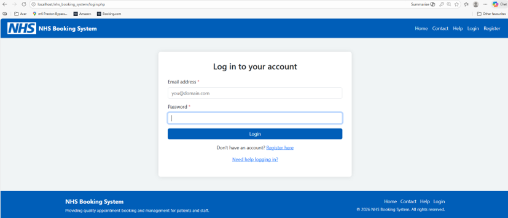

# NHS Appointment Booking System

A full-stack web application developed as a final-year computing dissertation project for a BSc (Hons) Computing degree, achieving a Grade B (65%). Built using a three-tier architecture that separates the front-end interface, PHP application logic, and the MySQL database.

## 🚀 Key Features
* **Role-Based Access Control:** Separate, secure dashboards for Patient and NHS Staff roles.
* **Secure Authentication:** Implemented secure user registration, password hashing, session management, and input validation.
* **Comprehensive Dashboards:** Supports appointment booking, cancellation, status tracking, staff administration, and contact enquiries.
* **Responsive Design:** Cross-device compatible layout optimized for both desktop and mobile users, adhering to GDPR data protection principles.

## 🛠️ Tech Stack
* **Frontend:** HTML5, CSS3, JavaScript, Bootstrap
* **Backend:** PHP
* **Database:** MySQL, phpMyAdmin (Relational database with Entity Relationship Diagram modeling)
* **Version Control:** Git & GitHub

## 📥 Local Setup Guide
1. **Clone or Download:** Download this repository or clone it using Git.
2. **Move to Server Directory:** Place the project folder inside your local server directory (e.g., `htdocs` if using XAMPP).
3. **Start Services:** Open the XAMPP Control Panel and start both **Apache** and **MySQL**.
4. **Import Database:** 
   * Open phpMyAdmin in your browser (`http://localhost/phpmyadmin`).
   * Create a new database and import the provided `.sql` database file included in this repository.
5. **Run the App:** Open your browser and navigate to `http://localhost/nhs-appointment-booking-system`.

## 🔑 Demo Accounts (For Testing Only)
> **Disclaimer:** *Demo accounts for testing purposes only. All data is completely fictional and not linked to any real NHS system.*

* **Staff Test Login:**
  * **Email:** `Staff@nhs.co.uk`
  * **Password:** `danny786`

* **Patient Test Login:**
  * **Email:** `Mihsaan21@gmail.com`
  * **Password:** `ihsaan123`

## 📸 Screenshots

